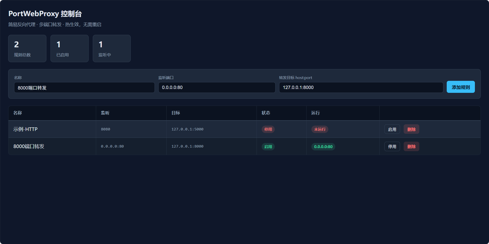

# PortWebProxy

Python 零依赖简易 TCP 端口转发器：多条「监听端口 → 转发目标」规则，纯字节双向管道透传（任意协议，含 HTTP），带 Web 管理界面，配置热生效。

## 界面预览

管理控制台（深色主题）：顶部统计卡片、规则新增表单、带实线分隔与斑马纹的规则列表，开关/删除即时生效。



## 快速开始

```bash
cd PortWebProxy
python app.py                 # 默认管理界面 http://127.0.0.1:9000
```

首次启动会自动生成 `config.json`（含一条示例规则 8080 → 127.0.0.1:5000，默认停用）。

打开浏览器访问 `http://127.0.0.1:9000`，即可增删改查转发规则、即时启停。

## 参数

| 参数 | 默认 | 说明 |
| --- | --- | --- |
| `--port` | 9000 | 管理界面端口 |
| `--host` | 127.0.0.1 | 管理界面绑定地址（勿直接暴露公网） |
| `--config` | config.json | 配置文件路径 |
| `--log-level` | INFO | 日志级别 |

## 规则字段

- `name`：显示名（可选）
- `listen`：`端口` 或 `host:端口`，省略 host 即 `127.0.0.1`
- `target`：`host:端口`，转发到的上游
- `enabled`：是否启用监听

## 设计说明

- 每条启用规则对应一个 TCP 监听，连接建立后立即进入双向字节管道，不解析协议头
- 适用于任意 TCP 协议（HTTP、MySQL、自研二进制协议等），字节原样透传
- 每方向 5 分钟空闲自动回收（`recv` 成功重置计时），防半开连接僵尸
- 所有规则变更在写盘与监听调整间加锁，保证原子热生效
- 端口绑定失败自动回滚到旧配置，不留脏规则

## 限制

- 管理界面无鉴权，仅限本机 / 受控网络使用
- 不终结 HTTPS/TLS、不做连接池复用
- 上游不可达时客户端快速收到连接重置并记日志

## 运行环境

- **Python**：3.8+（纯标准库，无第三方依赖；打包版无需用户侧装 Python）
- **操作系统**：
  - **Windows**：Win10/11 x86_64（`PortWebProxy.exe` 单文件，双击或命令行运行）
  - **Linux**：Debian/Ubuntu 22.04+、Fedora 38+、RHEL 9 等较新发行版（glibc ≥ 2.34；更老的 distro 可能跑不起来）
  - **macOS**：macOS 12+（Apple Silicon 与 Intel 通用；首次运行被 Gatekeeper 拦时右键→打开，或 `xattr -d com.apple.quarantine PortWebProxy`）

## Releases 下载

- **GitHub**（推荐，自动 CI 构建 Linux/macOS）：https://github.com/Lusensec/PortWebProxy/releases
  - 3 个 artifact：`PortWebProxy.exe`（Windows）/ `PortWebProxy-linux-x86_64.tar.gz`（Linux）/ `PortWebProxy-macos-universal.zip`（macOS）
  - 下载后：Windows 双击 exe；Linux `tar -xzf ... && chmod +x PortWebProxy && ./PortWebProxy`；macOS `unzip ... && chmod +x PortWebProxy && ./PortWebProxy`
- **Gitee**（国内镜像）：https://gitee.com/lusensec/PortWebProxy/releases
  - Gitee 的 v5 API 不支持直接上传二进制 asset，所以 Gitee release 页只放**说明 + 指向 GitHub Release 的下载链接**，3 个平台 artifact 统一从 GitHub 下。国内访问 GitHub 慢可走代理，或 `git clone` 后本地 `pyinstaller` 打包（见下方「从源码运行」）。

## 从源码运行（Python 原项目通用）

Python 源码项目**通用**：任何 Python 3.8+ 环境（Windows/Linux/macOS）都可直接 `python app.py` 运行，无需打包。打包只是省去用户装 Python 的步骤，功能与源码完全一致。

```bash
cd PortWebProxy
python app.py --port 9000 --config config.json
```

打包命令（PyInstaller）：

| 平台 | 命令 |
|---|---|
| Windows | `pyinstaller --onefile --console --clean --name PortWebProxy --add-data "web/static;static" app.py` |
| Linux / macOS | `pyinstaller --onefile --console --clean --name PortWebProxy --add-data "web/static:static" app.py` |

> 注意 `--add-data` 的分隔符：Windows 用 `;`，Unix 用 `:`。CI 已按平台处理。

