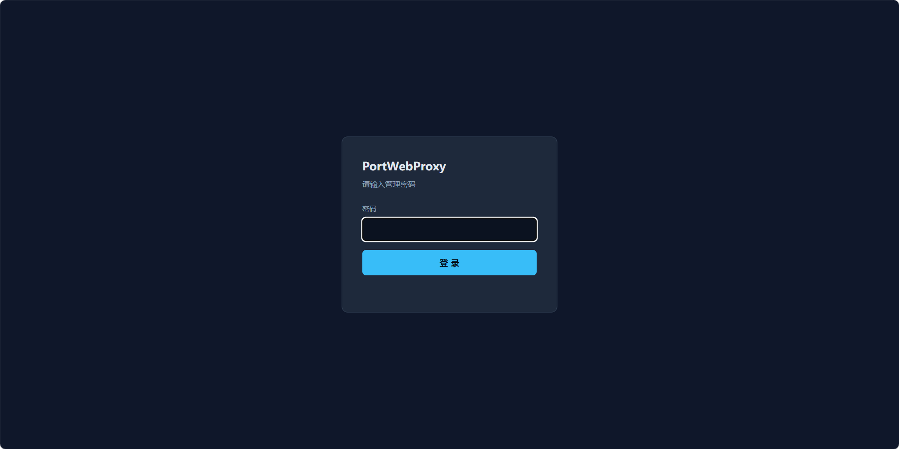

# PortFerry

Python 零依赖简易 TCP 端口转发器：多条「监听端口 → 转发目标」规则，纯字节双向管道透传（任意协议，含 HTTP），带 Web 管理界面，配置热生效。

## 界面预览

管理控制台（深色主题）：顶部统计卡片、规则新增表单、带实线分隔与斑马纹的规则列表，开关/删除即时生效。


## 快速开始

```bash
cd PortFerry
python app.py                 # 默认管理界面 http://127.0.0.1:9000
```

首次启动会自动生成 `config.json`（含一条示例规则 8080 → 127.0.0.1:5000，默认停用）。

打开浏览器访问 `http://127.0.0.1:9000`，即可增删改查转发规则、即时启停。

## 参数

| 参数 | 默认 | 说明 |
| --- | --- | --- |
| `--port` | 9000 | 管理界面端口 |
| `--host` | 127.0.0.1 | 管理界面绑定地址（勿直接暴露公网） |
| `--config` | config.json | 配置文件路径 |
| `--password` | 无 | Web 管理界面登录密码（覆盖 config 中的 `password`） |
| `--password-expiry-hours` | 24 | 登录会话有效期（小时） |
| `--log-level` | INFO | 日志级别 |

## 认证（可选）

管理界面无鉴权是默认行为；暴露公网前建议开启登录密码，**转发流量不受影响**（只锁管理面）：

- **CLI 临时**：`python app.py --password mysecret`（仅本次运行，不落盘）
- **config 持久**：在 `config.json` 顶层加 `"password": "mysecret"`（重启自动生效）；可选 `"password_expiry_hours": 24`
- 优先级：`--password` > `config.password` > 无密码（免登录）
- 登录后右上角可**修改密码** / **退出**；改密即时生效
- 会话 Cookie 为 HMAC 签名 + 24h 过期，`HttpOnly` + `SameSite=Strict`

登录页（启用密码后访问管理界面跳转至此）：



```jsonc
// config.json
{
  "rules": [ ... ],
  "password": "mysecret",
  "password_expiry_hours": 24
}
```

## 规则字段

- `name`：显示名（可选）
- `listen`：`端口` 或 `host:端口`，省略 host 即 `127.0.0.1`
- `target`：`host:端口`，转发到的上游
- `enabled`：是否启用监听

## 设计说明

- 每条启用规则对应一个 TCP 监听，连接建立后立即进入双向字节管道，不解析协议头
- 适用于任意 TCP 协议（HTTP、MySQL、自研二进制协议等），字节原样透传
- 所有规则变更在写盘与监听调整间加锁，保证原子热生效
- 端口绑定失败自动回滚到旧配置，不留脏规则

## 限制

- 管理界面无鉴权，仅限本机 / 受控网络使用
- 不终结 HTTPS/TLS、不做连接池复用
- 上游不可达时客户端快速收到连接重置并记日志

